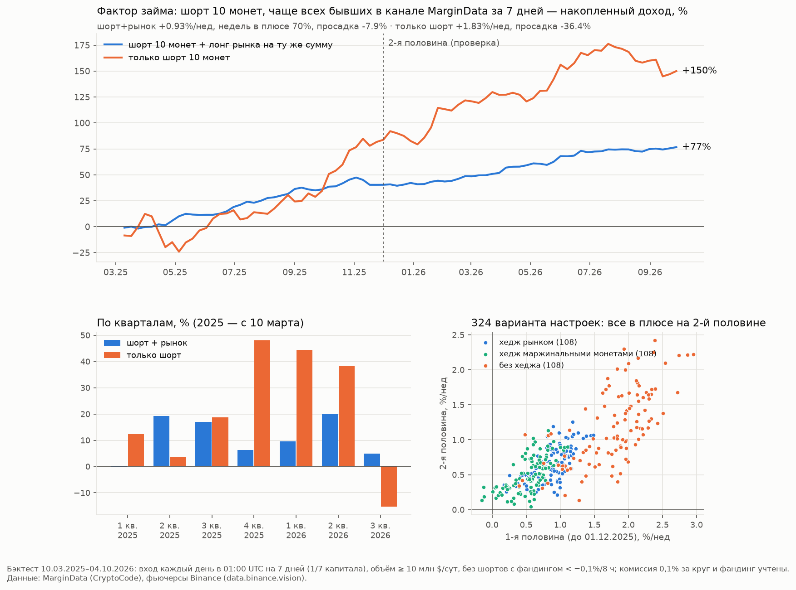

# Восьмой поиск: займы и лимиты MarginData — логика автора, новые данные и свой фактор (22.10.2026)

## Коротко

- **Найдено: фактор займа.** Монеты, которые дольше всех держатся в канале MarginData за неделю (их постоянно занимают
  на марже Binance), следующую неделю падают сильнее рынка. Корзина «шорт 10 таких монет + лонг рынка на ту же сумму»:
  +0,93% в неделю (t 4,3), обе половины истории в плюсе, просадка −7,9%. Только шорт: +1,83% в неделю, просадка −36%.
- **Это не повторяется ценой.** Те же корзины, собранные по волатильности, росту, фандингу, объёму и т. п., — около нуля
  или в минусе. Эффект держится и после поправки на десять ценовых признаков.
- **Проверки пройдены.**
  - Подбор по 1-й половине: все 324 варианта настроек в плюсе на 2-й.
  - Все 7 дней входа в плюсе.
  - Без 10 самых прибыльных монет: +0,69% в неделю (t 3,0).
  - Делистингованные монеты в данных есть.
- **Не подтвердилось:**
  - ончейн-притоки как отдельный сигнал;
  - анонсы маржинальных пар;
  - займ перед делистингом;
  - аномалии займа по одной монете;
  - режим рынка по сумме займов;
  - «выкачка пула» без данных пула;
  - позиции топ-трейдеров при событиях канала.
- **Лимиты (стакан) на альтах.**
  - Имбаланс автора (перевес бидов над асками на 3%) не предсказывает ничего.
  - Работает толщина стакана к обороту: шорты монет с самым толстым стаканом почти не зарабатывают. Это почти обратная
    волатильность.
  - Фильтр «из топ-10 по займу брать 5 самых волатильных» в журнале: +3,0% на сделку против +2,2%, просадка вдвое ниже,
    обе половины в плюсе.
- **Не хватает данных:** истории ставок маржи и доступного пула — того, на чём автор строит «выкачку пула». Публичные
  ставки Binance меняются каждый час, но истории нет. Её можно копить самим или запросить ключом на сервере.



## Что изучено у автора: займы и лимиты

**Канал MarginData.**
- До 02.09.2025 — четыре колонки `ASSET BOR.D REP.D B/R`. После — `SYM BOR REP B/R CHNG`.
- CHNG добавили потому, что Binance отдаёт только суточные займы, а отдача по мелким монетам приходит с опозданием.
  CHNG обновляется примерно раз в час.
- Новых форматов до 21.10.2026 не было.

**Платный бот (07.2025):** B.PREV / B.NOW / B.DIF / B.PCT, в основном сигналы в шорт.

**Платформа 2026 года:** Borrow, Repay, Volume, Net, B.Z / R.Z (z > 2 — аномалия), BΔ% / RΔ% (активность), BΔZ / RΔZ,
Available Pool.

**Логика автора по займам.**
- Занятый актив — будущий рыночный ордер. Займ стейблов — покупка; займ BTC — шорт, кроме флэта после лоёв.
- Займ альта — шорт. Исключения:
  - займ реализовали в лимиты и цена пошла вверх;
  - займ растёт, цена стоит, продажи «принимают в лимиты» → займ невыгоден, его будут отдавать → сквиз вверх.
- Кумулятивная дельта займа USDT около 3 млрд $ — перегрев, шорт; сильно отрицательная — «деньги на откуп», лонг.
  Капитуляция (массовая отдача) — разворот.
- «Выкачка пула» (2026, лонг): флэт + аномалия займа + доступный пул падает + кумулятивная дельта спота растёт + фандинг
  слегка отрицательный → памп 20–30%.

**Лимиты.**
- Имбаланс стакана на глубине 3%: зоны ±0,5. Глубины 3/5/8/15/30%. Важна динамика, а не одна заявка.
- R10/R30, TCM, тепловая карта Z-Score лимитов: зелёный — биды копятся, оранжевый — уходят, красный — копятся аски.
- «Займы росли, а лимиток нет → потом отдача → цена вниз».

## Данные

- **MarginData:** 174 205 постов, 20.02.2025–21.10.2026, 497 монет.
- **Фьючерсы:** 15-мин свечи 869 фьючерсов USDT-M и фандинг.
  - Делистингованные монеты в данных есть. После делистинга архив Binance продолжает свечи по цене расчёта, поэтому
    шорт закрывается по ней.
- **Позиции на фьючерсах:** 5-мин метрики (data.binance.vision) для 48 693 событий канала, покрытие 97%:
  - ОИ;
  - лонг/шорт топ-трейдеров по счетам и по позициям;
  - лонг/шорт всех счетов;
  - тейкеры.
- **Ончейн:** балансы кошельков Binance по токенам (DefiLlama, binance-cex), ежедневно с 11.2022. По альтам — в основном
  с 12.2025.
- **Анонсы Binance:** 7192 статьи с датами, из них 95 о маржинальных парах.
- **Стакан фьючерса** (bookDepth, накопленный объём на ±1…5%) за сутки до входа по каждой позиции шорт-корзины.
- **Ставки маржи Binance** (публичная VIP-спецификация, 490 активов): только текущие, два снимка 22.10.

## Не подтвердилось

| Гипотеза | Что показали данные |
|---|---|
| Приток токена на кошельки Binance (+5…25% баланса) → падение | Слабо: за 72 ч −1,1%, шорт 7/15 — +0,36…+0,43% на сделку. |
| Отток токена с кошельков Binance как сигнал | Нет. Квинтили изменения баланса без порядка. Шорт 10 монет с сильнейшим оттоком — около нуля. |
| Анонсы маржинальных пар | В основном служебные изменения котируемых пар. |
| Займ растёт перед делистингом или мониторингом | Опережения нет. |
| Аномалии займа по монете (B.Z, BΔZ, займ к объёму) | Слабо и неустойчиво. Займ к обороту не ранжирует: квинтили без порядка, спред −0,40% в неделю (t −0,8). |
| Режим рынка по сумме займов (z-оценка) | Неустойчиво: 11 из 21 месяца в плюсе. |
| «Выкачка пула» без данных пула (флэт + B.Z + фандинг) | Лонг без преимущества. |
| Кто занимает: ОИ, лонг/шорт топ-трейдеров, тейкеры при событиях канала | Эффекты 0,2–0,6% на сделку, по половинам неустойчиво (подробнее ниже). |

**Кто занимает** (`whoborrows.py`): события канала × позиции на фьючерсе, сделки 10/25 за 48 ч, одна на монету за 24 ч.
- Вход монеты в канал (28 167 событий): шорт +0,18%.
  - Топ-трейдеры в лонг (≥ 2 по позициям) — шорт +0,41% (1-я/2-я +0,58/+0,25).
  - Толпа в лонг (лонг/шорт всех счетов ≥ 2,5) — +0,30%.
  - Толпа в шорт (≤ 0,8) — −0,41%.
- Всплеск отдачи (738): шорт +0,93%.
  - Лонг/шорт топ-трейдеров за 4 ч падает — +1,59%, но на 2-й половине +0,72% против +0,60% у всех.
- Направление общее: шорт лучше, когда фьючерсная толпа в лонге. Но прибавка мала и на 2-й половине почти исчезает.

## Найдено: фактор займа

### Правило

- Каждый день в 01:00 UTC для каждой монеты считается **доля постов MarginData за прошлые 7 дней** (до 00:00 UTC), где
  она была.
- Вселенная: фьючерсы USDT-M Binance со средним объёмом за 7 дней ≥ 10 млн $ в сутки.
- **Шорт 10 монет с наибольшей долей.** Пропускаются монеты с фандингом сейчас дешевле −0,1% за 8 ч: шорты там уже
  переполнены, риск сквиза.
- Держим 7 дней, без тейка и стопа. Комиссия 0,1% за круг, фактический фандинг.
- Хедж — лонг рынка (все монеты вселенной поровну) или BTC на ту же сумму.
- **Лесенка.** В бэктесте вход каждый день на 1/7 капитала, недельный доход усреднён по всем дням входа. Понедельник был
  лучшим днём, поэтому оценка по одному понедельнику завышена.

### Результат (10.03.2025–04.10.2026, `factor8b.py`, `factor9.py`)

| Вариант | В неделю | t | 1-я / 2-я половина | Просадка | Недель в плюсе |
|---|---|---|---|---|---|
| Шорт 10 + лонг рынка | +0,93% | 4,33 | +1,06% / +0,82% | −7,9% | 70% |
| Шорт 10 + лонг BTC | +0,92% | 3,72 | +1,16% / +0,72% | −8,6% | 71% |
| Шорт 10 + лонг маржинальных монет | +0,70% | 3,59 | +0,70% / +0,70% | −9,6% | — |
| Только шорт 10 | +1,83% | 2,33 | +2,15% / +1,55% | −36,4% | 61% |

- **Бета.** Бета шорт-корзины к BTC около 1,0: хедж BTC на ту же сумму работает так же, как хедж рынком.
- **Квинтили среди монет канала** (`factor.py`, по понедельникам): Q0 (реже всех в канале) −0,79% … Q4 (чаще всех)
  −2,63% в неделю, порядок монотонный. Спред +1,84% в неделю (t 3,5), 1-я/2-я половина +1,25/+2,39%.
- **Состав корзины.** По сравнению с остальными монетами канала у монет корзины:
  - доля постов: медиана 33% против 2%;
  - объём растёт: ×1,45 к среднему за месяц;
  - волатильность выше;
  - фандинг за неделю −1,05%: шорты на фьючерсе тоже платят.

  То есть на монету давят и через маржу на споте, и на фьючерсе, а она всё равно падает дальше — даже с учётом того,
  что шорты платят фандинг.
- **Обновление корзины.** За всё время в корзине побывали 335 монет. Состав совпадает со вчерашним на 69%, с недельной
  давности — только на 14%. Это не «вечный шорт» одних и тех же монет.

### Проверки на честность

1. **Не цена** (`factor5a.py`, `factor7.py`).
   - Регрессии Фамы–Макбета с десятью ценовыми признаками: доходность за 1/7/30 дней, волатильность, максимум дневного
     роста, рост объёма, фандинг сейчас и за неделю, доля покупок тейкеров, ликвидность. Доля в канале остаётся
     значимой: −2,21% в неделю между верхом и низом ранга (t −2,9), 1-я/2-я −2,30/−2,13.
   - Ценовые аналоги той же корзины — «шорт топ-10 по признаку + лонг рынка», входы по понедельникам:

     | Признак | В неделю |
     |---|---|
     | Волатильность | −1,15% |
     | Рост за 7 дней | −0,06% |
     | Фандинг за неделю | −1,51% |
     | Покупки тейкеров | −1,61% |
     | Максимальный дневной рост | −0,51% |
     | Падение за 30 дней | +0,66% (t 1,3) |
     | Доля в канале | **+1,36% (t 4,8)** |

   - Внутри одних маржинальных монет рост за 7 дней тоже работает: +0,84% в неделю (t 2,8). Займ сильнее.
     Сочетание «займ + рост» или «займ + волатильность» прибавляет на 1-й половине, на 2-й — нет (+0,75…+0,81%).
     Оставлен чистый займ.
2. **Не случайность внутри канала** (`factor4.py`). 300 раз выбирали 10 случайных монет канала с тем же фильтром:
   в среднем +1,03% в неделю, максимум +2,48%. У топ-10 по доле — +3,21% (шорт, понедельники, объём ≥ 10 млн $).
3. **Подбор только по 1-й половине** (`factor8b.py`). Сетка из 324 вариантов:
   - окно 3/7/14 дней;
   - топ-5/10/20;
   - объём ≥ 3/10/20 млн $;
   - фильтр фандинга: нет / −0,05 / −0,1 / −0,2%;
   - хедж: рынок / маржинальные / нет.

   На 2-й половине:
   - в плюсе 100% вариантов, t > 2 у 46%, медиана +0,68% в неделю;
   - ранговая корреляция вариантов между половинами — 0,78;
   - лучший по 1-й половине с хеджем рынком (окно 3, топ-10, ≥ 10 млн, фильтр −0,1%): +1,05% (t 4,1) → +0,64% (t 3,1).
4. **День входа** (`factor8.py`). Рыночно-нейтральная пара в плюсе при любом дне входа:
   - пн +1,34%, пт +1,31%, сб +1,10%, вс +1,00%;
   - вт +0,63%, чт +0,66%, ср +0,50%.

   Отсюда лесенка вместо понедельника.
5. **Затухание.** В пересчёте на день удержания: 1 день — +0,07%, 3 дня — +0,15%, 7 дней — +0,13%, 14 дней — +0,08%.
   Держать 3–7 дней.
6. **Не держится на нескольких монетах** (`factor11.py`). Без 3/5/10 самых прибыльных монет: +0,82/+0,78/+0,69% в неделю
   (t 3,8/3,6/3,0).
7. **Стопы вредят** (`factor12.py`). Стоп на +40/+60/+100% к цене входа: +0,61/+0,70/+0,74% в неделю против +0,93% без стопа.
   - Сквизы до +100% внутри недели в основном откатываются: стоп +100% срабатывает у 1,1% позиций, а к концу недели выше
     +100% только 0,1%.
   - Поэтому шорт — **без плеча**: при ×1 ликвидация примерно и есть «стоп +100%».
8. **Худшие недели** (шорт + рынок):
   - 17.11.2025 −4,7% (PARTI −95%);
   - 10.11.2025 −2,3% (RESOLV −48%);
   - 24.03.2025 −1,9% (VIDT −75%);
   - 15.09.2025 −1,7%;
   - 17.08.2026 −1,6% (ONG −140%).

   Кварталы (шорт + рынок): 6 из 7 в плюсе, 1-й квартал 2025 (с 10 марта) −0,3%.
9. **Рост и падение рынка.** Корреляция пары с BTC — 0,00. Только шорт от рынка зависит сильно.

   | Недели | Шорт + рынок | Только шорт |
   |---|---|---|
   | BTC вырос (43) | +1,05% | −1,72% |
   | BTC упал (39) | +0,80% | +5,75% |
   | Сильный рост BTC > +5% (7) | +0,27% | −8,2% |

### Как вёл бы себя журнал в боте (`journal_sim.py`)

Каждый день в 01:00 UTC шорт монет из топ-10, которых нет среди открытых, на 7 дней; одна открытая сделка на монету.
Маржа 1 USDT × 1.

| | Сделок | В неделю | Открыто одновременно | На сделку (медиана) | В плюсе | 1-я / 2-я половина | Итог, USDT | Просадка, USDT |
|---|---|---|---|---|---|---|---|---|
| Шорт | 1495 | 18 | ~18 | +2,24% (+3,52%) | 62% | +2,08% / +2,38% | +33,5 | −10,0 |
| Шорт + лонг BTC на ту же сумму | 1495 | 18 | ~18 | +2,29% | 65% | +2,22% / +2,35% | +34,2 | −5,1 |

- **Хвосты.** Худшая сделка −161% (BICO). Хуже −30% — 59 сделок, хуже −50% — 22.
- **Топ-5 вместо топ-10:** 859 сделок (10,5 в неделю), +2,39% на сделку, итог +20,5 USDT, просадка −4,4 USDT.

## Где живёт эффект

- **Устойчивость, а не размер займа.** Займ к обороту (BOR / объём) не ранжирует. Работает то, что монету занимают
  день за днём.
- **Монеты без маржи — отдельный мир.** Самые волатильные монеты, которых не было в канале 90 дней (скорее всего,
  маржи на споте нет вовсе), в среднем растут на +2,7% в неделю, но медиана −2,9%. Это лотерея с редкими пампами:
  сквизы, когда спот нельзя занять и продать. Отдельное наблюдение, не стратегия.
- **Ончейн внутри корзины** (`factor10b.py`). Шорты монет, у которых за неделю до входа с кошельков Binance ушло > 5%
  баланса, отработали лучше: +4,4% на эпизод против +2,4% у остальных, во всех трёх подпериодах.
  - Возможный смысл: занятые токены выводят и продают на других площадках.
  - Но данных мало (ончейн по альтам в основном с 12.2025), разница около 1,7 стандартной ошибки, медианы близки
    (+3,9% против +3,2%).
  - Как фильтр — пока не включать, наблюдать.

## Лимиты (`bd_basket.py`, `bd_analyze.py`, `bd_analyze2.py`, `bd_analyze3.py`)

Для каждой из 5730 позиций шорт-корзины взят стакан фьючерса за сутки до входа (данные есть у 5726). Это bookDepth:
накопленный объём на ±1…5% от цены, снимки примерно раз в 30 с.

**Имбаланс автора (биды против асков) не работает.**
- Зоны ±0,5 на 3% почти не встречаются: 57 позиций из 5726. Медиана имбаланса +0,14 — на фьючерсах альтов биды на 3%
  обычно чуть толще асков.
- По имбалансу на 1/3/5% порядка нет. Перевес бидов шорту не мешает: при 0,2…0,5 — +2,65% на позицию, при 0,05…0,2 —
  +1,80%.
- Отношение бидов к аскам, квартили внутри дня: +1,86 / +1,52 / +1,88 / +2,12% — плоско.
- Динамика за сутки: «биды уходят» (≤ −0,15) — +4,5% (241 позиция, обе половины в плюсе), «биды копятся» — +2,1%.
  Между ними порядка нет.

**Работает толщина стакана к обороту** — и бидов, и асков: по рангу они совпадают на 96%.

| Биды на 3% к суточному обороту, квартили внутри дня | Q1 (тонкий) | Q2 | Q3 | Q4 (толстый) |
|---|---|---|---|---|
| Шорт на позицию, % | +2,81 | +2,80 | +1,94 | +0,17 |
| 1-я / 2-я половина, % | +2,03 / +3,48 | +3,25 / +2,42 | +2,56 / +1,40 | +0,91 / −0,47 |

- **Фильтр по стакану.** Без четверти с самым толстым стаканом (по дню): +1,29% в неделю (t 5,4), 1-я/2-я +1,32/+1,27%.
  Если выкидывать случайную четверть (200 раз): +0,94%, максимум +1,09%.
- **Это почти обратная волатильность.** Корреляция рангов толщины стакана и волатильности −0,84. Толстый стакан —
  спокойная монета, где давления займа не хватает.
- **Тот же эффект без стакана — по волатильности.** Выкидываем самые спокойные монеты корзины по волатильности за
  7 дней (по дню):

  | Выкинуто самых спокойных | 0% | 10% | 25% | 40% | 50% |
  |---|---|---|---|---|---|
  | Шорт + рынок, 1-я / 2-я половина, % в неделю | +1,06 / +0,83 | +1,12 / +0,89 | +1,18 / +1,03 | +1,42 / +1,35 | +1,45 / +1,52 |

  Улучшение растёт монотонно в обеих половинах.
- **Смысл.** Трактовка автора «займ + продажи принимают в лимиты → сквиз» в виде перевеса бидов не подтверждается.
  Подтверждается её общая часть: где стакан толстый (лимиты гасят продажи), займ цену не продавливает; где тонкий —
  продавливает.

**Журнал с фильтром** (`journal_sim2.py`): из топ-10 по займу берём 5 самых волатильных. Одна открытая сделка на монету,
7 дней, маржа 1 USDT × 1.

| | Сделок (в неделю) | На сделку (медиана) | В плюсе | 1-я / 2-я половина | Итог, USDT | Просадка, USDT |
|---|---|---|---|---|---|---|
| Шорт | 884 (10,8) | +3,03% (+4,99%) | 64% | +2,82% / +3,20% | +26,8 | −5,2 |
| Шорт + лонг BTC | 884 (10,8) | +3,26% | 68% | +3,23% / +3,28% | +28,8 | −2,4 |

Без фильтра (топ-10): +2,24% на сделку, +33,5 USDT, просадка −10,0. С фильтром сделок меньше, каждая лучше, просадка
вдвое ниже. Хуже −50% — 18 сделок из 884.

## Связь с логикой автора

- **«Займ на альте → шорт»** подтверждается в виде фактора: постоянно занимаемые монеты хуже рынка. На этом же стоят
  правила 1 и 2 бота и журнал ↩️.
- **«Займ + продажи принимают в лимиты → сквиз»** в виде перевеса бидов не подтверждается. Подтверждается в общем виде:
  при толстом стакане займ цену не продавливает.
- **«Выкачка пула» (лонг)** проверить нельзя: нет истории пула и ставок. Наш прокси без пула лонга не дал.

## Чего не хватает и как добыть

> **Обновление 22.10.2026 (research/s11).**
> - История ставок оказалась публичной (без ключа) с 2023 года. Скачана за 2 года по 625 активам.
> - Дорогой займ предсказывает падение цены, но шорты на фьючерсах платят за это фандингом: после фандинга эффекта нет.
> - Скачки ставки («выкачка пула») — лотерея на сквизах, без устойчивого сигнала.
> - Канал ставка не заменяет; журнал 🏦 оставлен как есть.

- **Ставки маржи Binance по 490 активам меняются каждый час.** 22.10 между 12:46 и 13:01 UTC ставка сменилась у 109
  из 490. Например, AUDIO 125 → 185% годовых, METIS 36 → 53%, MAGIC 104 → 54%.
  - Ставка растёт с загрузкой пула, так что это бесплатный аналог Available Pool автора.
  - Истории в открытом доступе нет. Её можно копить снимком раз в час с публичного адреса без ключа.
- **Через ключ на сервере** (только чтение):
  - доступный пул — `GET /sapi/v1/margin/available-inventory`, только текущий;
  - история ставок — `GET /sapi/v1/margin/interestRateHistory`, до месяца за запрос; глубина хранения в документации не
    указана.

## Включено в бот 22.10.2026 (по решению владельца)

### 1. Журнал 🏦 «фактор займа» (`scanner.borrow_factor_rule`, `trader.VIRTUALS["virtual_BF"]`)

- **Журнал постов.** Каждый проход бот дописывает посты MarginData (все монеты поста) в `margin_posts.json` рядом
  с `state.json`, хранит 8 суток (~110 КБ).
- **Когда.** Раз в сутки, в первый проход после 01:00 UTC. Если бот лежал — до 04:00 UTC, позже день пропускается
  с записью в журнал службы.
- **Догрузка.** Если в журнале постов за 7 суток пауза дольше 2 ч (первый запуск, простой бота), бот догружает
  7 суток канала — около 2000 постов, ~2 мин.
- **Счёт и фильтры.**
  - Число постов за 7 суток до 00:00 UTC, где была монета.
  - Фильтры: бессрочный фьючерс старше 30 суток; объём за 7 суток ≥ 10 млн $ в сутки (15-мин свечи до 01:00);
    фандинг не дешевле −0,1% за 8 ч.
  - Первые 10 по числу постов, из них 5 с наибольшей волатильностью 15-мин доходностей за 7 суток.
- **Сделка.**
  - Виртуальный шорт: вход по марк-цене, держать 168 ч, без тейка, стоп +100%.
  - Маржа — как у бота (1 USDT), плечо ×1. Старт журнала 20 USDT, одна открытая сделка на монету.
  - На входе запоминается цена BTC. При закрытии бот считает тот же итог с лонгом BTC на ту же сумму и срок
    (с фандингом и комиссией) и показывает его рядом.
- **Повторы.** Если Binance не отдал свечи монеты, которая могла попасть в топ, — повтор через 5 мин, до 4 попыток.
- **Сверка с бэктестом** (`bf_parity.py`). На 64 днях истории бот выбирает те же 10 и те же 5 монет, что `journal_sim2.py`:
  совпадение 64 из 64.

### 2. Сборщик ставок маржи (`scanner.margin_rates_watch`)

- Раз в час, после HH:02 UTC: публичная VIP-спецификация маржи Binance, без ключа. По ~490 активам — дневная ставка
  и лимит займа VIP 0.
- Запись: `margin_rates/ГГГГ-ММ.csv.gz` рядом с `state.json`, строки «час,актив,ставка,лимит». Это ~4 МБ в месяц.
- Сбой — строка «СТАВКИ» в журнале службы не чаще раза в 6 ч; раз в сутки — сводка за прошлые сутки.
- В выгрузке `tools/export_signals.py` (v3) — раздел «ФАКТОР ЗАЙМА И СТАВКИ МАРЖИ»: покрытие журнала постов, файлы
  ставок.

### 3. История ставок через ключ (`tools/margin_rate_history.py`, разово на сервере)

```
curl -sL https://raw.githubusercontent.com/alexxmiasoedov-beep/margin_call/main/tools/margin_rate_history.py | python3
```

- **Ключ.** Берётся из файлов окружения бота и не печатается.
- **Запросы.** Только чтение: `GET /sapi/v1/margin/interestRateHistory`, VIP 0, окнами по 30 суток назад.
  - Глубина — по BTC, не больше 12 месяцев.
  - Длинный ответ дозапрашивается по краям.
- **Сохраняет** `margin_rates/history.csv.gz`.
- **Печатает:**
  - глубину и шаг истории;
  - доход фьючерса после скачка ставки (×2 и ×3 к медиане 14 суток, отдельно — во флэте);
  - квинтили монет по уровню ставки по понедельникам.

  Это первая прикидка, без фандинга и комиссий.

## Файлы

- **Данные:**
  - ончейн DefiLlama: `cex_build.py`, `cex_flow.py`;
  - анонсы Binance: `ann_fetch.py`, `ann_detail.py`;
  - займы до делистинга: `delist_lead.py`;
  - признаки событий канала: `ev_margin_feats.py`;
  - 5-мин метрики фьючерсов: `ev_metrics.py`;
  - стакан корзины: `bd_basket.py` (загрузка), `bd_analyze.py`–`bd_analyze3.py` (разбор);
  - ежедневная панель: `daily_panel.py`.
- **Первые разведки:** `explore1.py`, `explore2.py`, `whoborrows.py`.
- **Фактор:**
  - квинтили и пары: `factor.py`–`factor4.py`;
  - против цены: `factor5.py`, `factor5a.py`, `factor6.py`, `factor7.py`, `factor13.py`;
  - устойчивость: `factor8.py`, `factor8b.py`, `factor11.py`, `factor12.py`;
  - хедж и ончейн: `factor9.py`, `factor10.py`, `factor10b.py`;
  - журнал: `journal_sim.py`, `journal_sim2.py`; сверка бота с бэктестом: `bf_parity.py`;
  - график: `chart.py`.
