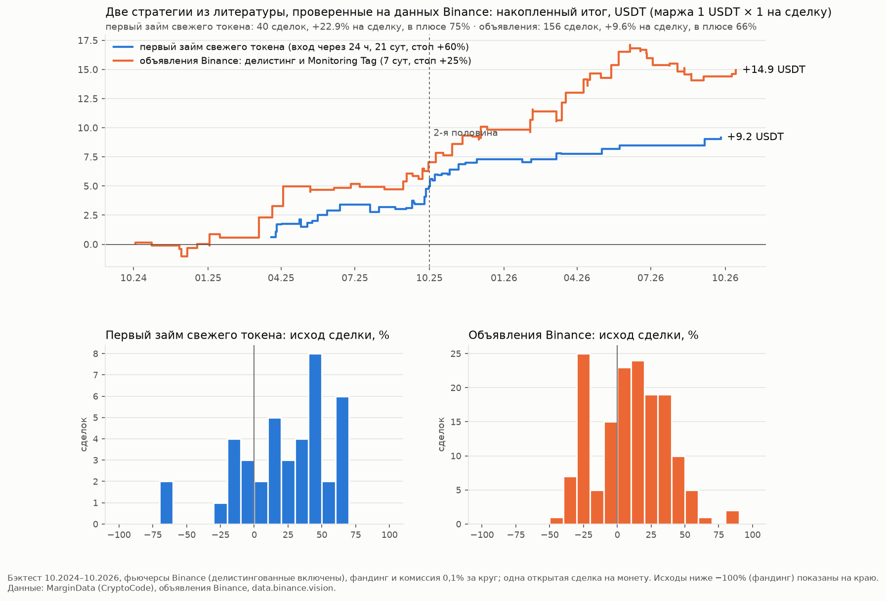

# Десятый поиск: стратегии из литературы Китая, Кореи, Казахстана и США — проверка на данных Binance (23.10.2026)

## Коротко

- **Литература.** Четыре исследователя прочитали около 130 источников на местных языках: китайском, корейском,
  казахском/русском, английском. Каждый выписал проверяемые правила со ссылками (`lit/*.md`).
  - Ни в одном регионе не нашлось работ, где займы на марже Binance по каждой монете используются для прогноза цены.
    Наш подход через MarginData выглядит уникальным.
  - Ближайшие идеи — «займ под сброс» у маркет-мейкеров при листингах (США, Китай) и short interest на фондовом рынке
    (США).
- **Найдено две стратегии**, обе прошли подбор по 1-й половине и проверку на 2-й:
  - **A. 🆕 Первый займ свежего токена.** Токен впервые появился в канале займов вскоре после спотового листинга на
    Binance → шорт фьючерса через сутки на 21 сутки. Это 40 сделок, +22,9% на сделку, 75% в плюсе, обе половины
    +23,6/+22,2%.
  - **B. 📢 Объявления Binance.** Делистинг спота, делистинг фьючерса или «Monitoring Tag» → шорт в течение 15 мин
    на 7 суток. Это 156 сделок, +9,6% на сделку, 66% в плюсе, обе половины +12,4/+8,0%.
- **Проверено и отклонено:**
  - премия фьючерса ≥ 0 как фильтр корзины 🏦 — вредит;
  - исключение «арбитражного хеджа» из 🏦 — неустойчиво;
  - лонг после капитуляции на объёме — ноль;
  - моментум и разворот с учётом размера — слабо (t ≈ 1,7);
  - шорт пампа на падающем открытом интересе (проверено ранее в s9) — убыточен.

## Литература по регионам (`lit/`)

| Регион | Источников | О чём пишут | Идеи для проверки |
|---|---|---|---|
| Китай (`china.md`) | 23 из ~45 страниц | FMZ (发明者量化) и медиа: исполнение важнее доказательств; монеты под контролем крупных игроков (庄家): открытый интерес к обращению, долгий отрицательный фандинг; листинги и делистинги; займы маркет-мейкерам; фандинг — арбитраж, а не фактор; маржа — только как «杠杆多空比» OKX | шорт делистинга с защитой от сквиза; затухание новых фьючерсов отдельно для спотовых и «только фьючерс»; фильтр займа по фандингу и базису; цикл сквиза |
| Корея (`korea.md`) | 34 | события бирж: пампы при листинге на Upbit, «запертые» пампы при закрытом вводе-выводе, предупреждения и делистинг; кимчи-премия как градусник розницы; манипуляции | шорт после листинга на Upbit; шорт на объявлениях Upbit/Bithumb; корзина премии; деление займа на хедж кимчи-арбитража и направленный |
| Казахстан / СНГ (`kazakhstan.md`) | 33 | казахстанские источники — регуляторика, P2P-премия тенге, маркетинг; практики СНГ — арбитраж фандинга, скринеры пампов, листинги; академия (ВШЭ: Добрынская) — моментум и разворот | шорт новых листингов; лонг на капитуляции; моментум и разворот; защита от «зомби-сквизов»; кэрри по фандингу |
| США (`usa.md`) | ~30 | академия: базис и фандинг — мера спроса на плечо; практики: описательные исследования событий; кэрри по фандингу выдохлось в 2025 | «дни на покрытие» и аномальный займ (аналоги short interest); «теперь можно шортить»; шорт новых листингов с условием раннего займа; премия как фильтр; индекс плеча рынка |

Недоступно:
- Китай: Zhihu, CSDN, Baidu, WeChat.
- Корея: блоги Naver, coinpan, уведомления Upbit (Cloudflare).
- США: SSRN, Wiley.
- Общий лимит поиска исчерпался у всех четырёх ближе к концу.

## A. 🆕 Первый займ свежего токена (`newlist*.py`, `firstborrow.py`)

**Как пришли.**
- Сначала проверили шорт любых новых фьючерсов (365 крипто-фьючерсов с 10.2024, TradFi — акции, фонды и металлы —
  исключены): в среднем около +1,5–2% на сделку, но держится на хвостах и неустойчив по кварталам.
- Разделение по займу:
  - токены, попавшие в канал займов до входа, — +13–14% на сделку;
  - остальные — −2…−9%.
- Внутри токенов со спотовым листингом Binance:
  - с займом шорт даёт +24,9%;
  - без займа −17,9%, такие токены растут.

  Займ различает «сброс» и «памп».
- В 2026 году Binance сменил порядок листинга: сначала фьючерс (Alpha / pre-market), спот с маржой — через недели.
  Поэтому событие привязано не к запуску фьючерса, а к **первому появлению токена в канале займов**.

**Правило.**
- Токен впервые появился в канале MarginData, у него есть фьючерс USDT-M.
- Объявление о спотовом листинге на Binance — в пределах ±10 суток от первого поста.
- Вход: шорт через 24 ч после первого поста, если фандинг сейчас не дешевле −0,1% за 8 ч.
- Держать 21 сутки. Стоп +60%. Досрочный выход, если фандинг ≤ −0,5% за 8 ч два раза подряд.

**Результат** (03.2025–10.2026, одна сделка на монету, фандинг и комиссия):

| Сделок | В месяц | На сделку | Медиана | В плюсе | 1-я / 2-я половина | С хеджем BTC | Итог, USDT (1 × 1) | Просадка, USDT |
|---|---|---|---|---|---|---|---|---|
| 40 | 2,2 | +22,9% | +29,2% | 75% | +23,6% / +22,2% | +20,9% | +9,2 | −0,6 |

**Проверки.**
- **Сетка без фильтров** (1/24/72 ч, 14/21/30 сут):
  - все свежие токены — +7,5…+16,6% на сделку;
  - старые токены, вернувшиеся в канал, — −1,5…+5,6%.
- **Подбор по 1-й половине** на схеме 2025 года (фьючерс + спот + займ): из 160 вариантов 85% в плюсе на 2-й половине,
  медиана +25,8%; без 5 лучших сделок в плюсе 90% вариантов.
- **По годам:** 2025 — +23,6% (31 сделка), 2026 — +20,7% (9).
- **Схема листинга:** с фьючерсом моложе 3 суток (схема 2025) эффект сильнее — +25% без фильтра фандинга. С фьючерсом
  старше (схема 2026) — +4,6…+11,9% в зависимости от входа и срока.
- **Худшие сделки** — сквизы: SYRUP, INIT, C, SOMI, AVNT, KITE, KAT (около −60%). Фильтр фандинга на входе убирает
  часть из них.
- **Смысл.**
  - Заёмщики на марже в первые дни свежего токена — это маркет-мейкеры и держатели аирдропов, которые «занимают под
    сброс». Если займа нет, продавцов меньше, и токен скорее растёт.
  - США: модели займов токенов маркет-мейкерам; исследование The Tie по 1844 листингам.
  - Китай: «займы маркет-мейкерам → снижение после листинга».
  - СНГ: падение новых листингов на 75–94% за 11–32 дня.

## B. 📢 Объявления Binance (`events_ann*.py`)

**Правило.**
- Событие: объявление Binance «Will Delist …» (спот), «Futures Will Delist …» или «Monitoring Tag … Include …».
- Вход: шорт фьючерса монеты не позже 15 мин после публикации; не входить при фандинге < −0,1% за 8 ч.
- Держать 7 суток, стоп +25%.

**Результат** (10.2024–10.2026, одна сделка на монету):

| Сделок | В месяц | На сделку | Медиана | В плюсе | 1-я / 2-я половина | Итог, USDT (1 × 1) | Просадка, USDT | Месяцев в плюсе |
|---|---|---|---|---|---|---|---|---|
| 156 | 6,4 | +9,6% | +10,7% | 66% | +12,4% / +8,0% | +14,9 | −3,1 | 17 / 24 |

- **По типам:** Monitoring Tag — +6,8% (88 сделок, 69% в плюсе); делистинг спота — +15,7% (45 сделок, 71%);
  делистинг фьючерса — +8,2% (23 сделки, 43%).
- **По годам:** 2025 — +15,8% (62 сделки); 2026 — +6,3% (81).
- **Сетка из 48 вариантов** (задержка 15/60 мин, 1/3/7/14 сут, стоп 15/25/40%, с защитой и без): все в плюсе на 2-й
  половине, медиана +3,9%; ранги вариантов согласованы (0,69).
- **Задержка входа важна:** 15 мин лучше часа. Срок 7 суток лучше 1–3 суток.
- **«Futures Will Delist Multiple … Contracts»** — монеты перечислены только в тексте объявления, поэтому в таблицу выше
  не попали. Отдельная проверка (`multi_delist.py`, те же условия): 16 объявлений, 41 сделка, +12,6% на сделку
  (медиана +11,6%, в плюсе 68%). Все такие объявления вышли во 2-й половине.

## В боте с 23.10.2026: журналы 🆕 и 📢

Оба журнала виртуальные, как 🏦: старт 20 USDT, сделка 1 USDT с плечом ×1, хедж BTC считается отдельной строкой.

- **🆕 `virtual_NT`** (`scanner.newtoken_rule`).
  - Первое появление монеты бот видит по своему журналу постов канала (8 суток). Монеты из архива канала
    с 20.02.2025 по 21.10.2026 свежими не считаются: 497 монет в `bot/margin_known.txt`.
  - Спотовые листинги бот берёт из объявлений Binance (раздел 48). Опрос раз в минуту, при первом запуске — 100
    последних объявлений.
  - Вход через 24 ч после первого поста. Если бот лежал, вход возможен до 72 ч. Если объявления о листинге ещё нет,
    бот ждёт его до 72 ч.
  - Остальное — как в правиле выше: фандинг на входе, 21 сутки, стоп +60%, досрочный выход по фандингу. Фандинг
    проверяется раз в 30 мин.
- **📢 `virtual_AN`** (`scanner.announce_rule`).
  - Разделы 48, 49 и 161 бот опрашивает раз в минуту, поэтому вход обычно через 1–2 мин после публикации.
    Объявление старше 60 мин — без сделки.
  - Для «Multiple» монеты берутся из текста объявления.
  - На монету — одна открытая сделка: повторное объявление по ней же пропускается.
- **Разбор заголовков совпадает с бэктестом:**
  - 176 из 176 событий 📢;
  - 333 из 333 листингов с тем же временем. В заголовках с несколькими монетами бот находит и вторую, и следующие.
- **Не учтены (как и в бэктесте):** тикеры не латиницей (牛来, 币安人生) и делистинг без даты в заголовке.

## Проверено и отклонено

| Идея (регион) | Результат |
|---|---|
| 🏦: только монеты с премией фьючерса ≥ 0 (США) | Хуже: −0,05% на сделку против +3,03%. Лучшие шорты как раз с отрицательной премией. |
| 🏦: исключить «арбитражный хедж» — фандинг ≤ −0,03% и премия ≤ −0,1% (Китай) | +3,25% против +3,03%, но 2-я половина хуже (+2,38% против +3,20%). Не включено. |
| 🏦: другие пороги фандинга (−0,03…−0,05%) | Не лучше −0,1%. Без фильтра — +1,45%. |
| Лонг после дневной капитуляции на объёме ×2–4 (СНГ) | Около нуля: медиана отрицательная, в плюсе 41–46%. |
| Моментум и разворот с учётом размера монеты (США, СНГ, Китай) | Моментум у крупных +1,85% в неделю (t 1,7), у остальных +0,78% (t 1,7). Слабо. |
| Удаление маржинальных пар | Почти всё — служебная чистка котировок BTC/FDUSD (s10). |
| Шорт пампа на падающем открытом интересе (СНГ) | Ранее в s9: шорт при закрытии шортов на росте теряет 3–6% на сделку. |

## Не проверено (нужны данные)

- **Корея: шорт после листинга на Upbit и после предупреждений/делистинга Upbit/Bithumb.** Нужна история уведомлений
  Upbit (закрыта Cloudflare). Время листинга можно взять по первой минутной свече Upbit.
- **Корея: корзина кимчи-премии и деление займа на хедж и направленный.** Нужна часовая история цен Upbit по всем
  монетам: около 22 тыс. запросов.
- **США: «дни на покрытие» и аномальный займ относительно истории монеты.** Можно на данных канала — следующий шаг.
- **США: индекс плеча рынка для размера хеджа.**
- **Китай: «откат 24 ч».** Нужны лимитные исполнения.
- **СНГ: кэрри по фандингу.** По источникам выдохлось к 2025.
- **Разлоки токенов.** Нет расписаний.

## Файлы

- `lit/china.md`, `lit/korea.md`, `lit/kazakhstan.md`, `lit/usa.md` — обзоры источников по регионам со ссылками и
  правилами.
- `common.py`, `lib.py` — общие данные и функции сделок.
- `ann_perp.py` — тексты объявлений о фьючерсах (отделение TradFi). `prem_load.py` — премия к индексу по всем
  фьючерсам.
- Стратегия A: `newlist.py` → `newlist2.py` (без заглядывания вперёд) → `newlist3.py` (спот и займ) → `newlist4.py`
  (сетка) → `firstborrow.py` (событие — первый займ).
- Стратегия B: `events_ann.py`, `events_ann2.py`, `multi_delist.py` (делистинг нескольких фьючерсов одним объявлением).
- Отклонённые: `bf_basis.py` (🏦 с базисом и фандингом), `simple_lit.py` (капитуляция, моментум).
- `final_sims2.py` — итоговые журналы. `chart.py` — график.
