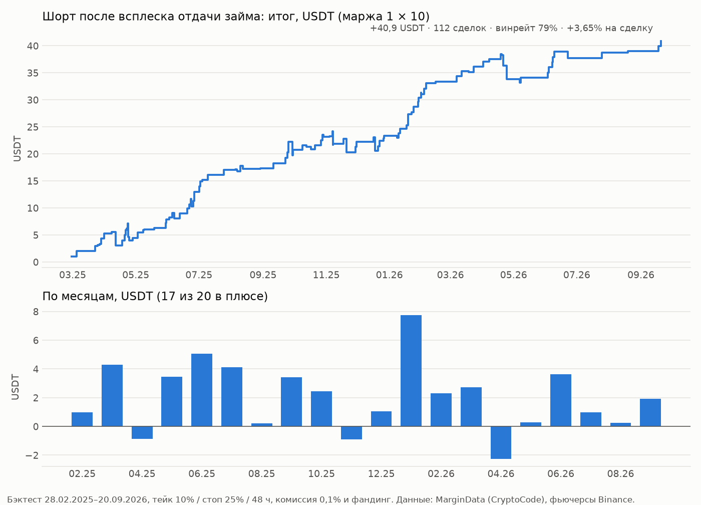

# Седьмой поиск: канал CryptoCode (t.me/cryptocoddee) — логика автора и проверка на данных (22.10.2026)

## Что изучено

- **Посты канала.** Все посты с 18.01.2024, за два года (22.10.2024–21.10.2026) — 1474 поста, 1925 картинок, 306 тыс. знаков
  (`cc_scrape.py`, `cc_parse.py`, открытая веб-версия t.me/s/, без входа в Telegram).
- **Статьи.** Все 63 статьи блога teletype.in/@formulatrade (08.2024–09.2026, `cc_articles.py`), 16 статей telegra.ph
  (02–08.2024), 5 открытых страниц Notion (`cc_notion.py`), презентация «Функции алгоритмов ФормулаТрейдинга». Главная
  страница Notion (на неё 56 ссылок) и дашборд Grafana закрыты.
- **Боты автора.**
  - Открыты: «MarginData» (cryptocode_margin_data) — тот самый канал, по которому работает наш бот, и «Funding Binance»
    (фандинг, до 10.2025).
  - Закрыты: бот ОИ, ликвидации, стакан, дельта, арбитраж фандинга, парный z-score.
- **Видео.** 280 ссылок на YouTube (стримы) не разбирались.

## Логика автора

Автор — дискреционный трейдер, продаёт подписку на платформу CryptoCode и обучение. Его инструменты:

**Маржинальные займы Binance** — главная тема с 2025 года.
- **Рынок.** Кумулятивная дельта займа USDT: ~3 млрд $ — «перегрев», шорт; отрицательная дельта — «свободные деньги на
  откуп», лонг. Займы BTC и USDC трактуются по ситуации. Правило 2026 года: «лонги, когда выносят маржу; шорты, когда
  набирают маржу».
- **Альты (MarginData: BOR, REP, B/R, CHNG).** Трактовки менялись.
  - 2024 — начало 2025: «займы растут, а цена не падает → сквиз вверх»; «отдача займа → маркет-покупки → рост».
  - С весны 2025: «займ после роста → шорт»; «CHNG > 1 после роста → шорт»; «импульс ≥ 50% + займ + фандинг падает +
    ОИ падает на росте → шорт».
  - С осени 2025: «выкачка пула» — флэт + аномальные займы + доступный пул выбирают + отрицательный фандинг → памп 20–30%.

**Лимиты (стакан).**
- R10/R30 — биды к аскам по всему рынку на 10% и 30%.
- TCM — число монет с очень крупными бидами.
- Имбаланс на глубинах 3–15%: зоны ±0,5 на 3%.
- Градиент 3% против 15%; тепловая Z-Score лимитов («> 5 — сильный перевес»).

**Маркет-ордера.** DMI: «крупные покупки не двигают цену → разворот вниз», границы ±4 (BTC ±3). SMF — «крупный участник».

**Прочее.**
- ОИ: импульс ОИ + покупки → лонг; падение ОИ на росте → шорт.
- Агрегированный фандинг (группы HIGH/STANDARD/LOW/NEGATIVE, MID).
- Опционы: стрэдл при низкой волатильности, зоны страйков, хитмап крупных.
- Ончейн-кошельки ММ.

## Проверка

Данные:
- MarginData — 174 205 постов с 20.02.2025, 497 монет;
- 15-мин свечи 869 фьючерсов с покупками тейкеров;
- фандинг;
- стакан фьючерса BTC (bookDepth) за 2 года;
- индекс волатильности DVOL (Deribit).

Сделки — тейк/стоп за 48 ч, стоп первым в общей свече, комиссия 0,1%, фактический фандинг. Проверка на двух половинах
(до и после 01.12.2025) и на перемешанных исходах.

| Утверждение автора | Что показали данные |
|---|---|
| Займ во флэте / «выкачка пула» → лонг | Нет. Лонг после появления монеты в боте или скачка займа во флэте: −0,2…−0,5% на сделку (30/15, 20/10). С отрицательным фандингом — около нуля (+0,2%). |
| Отдача займа → откуп, лонг | **Наоборот.** После всплеска отдачи цена падает: шорт 10/25 — +0,9% (займ ≥ 1 млн $ — +1,4%) против +0,36% у базы «монета просто в канале». Сильнее всего — после сильного хода цены (ниже). |
| Монета в боте после падения → сквиз вверх | Нет своего эффекта: отскок после −10% за сутки у монет без канала даже лучше (+0,38% против −0,20%). |
| CHNG > 1 после роста → шорт | **Подтверждается.** После роста ≥ 15%: шорт 7/20 +2,0% (винрейт 82%), база в канале — +1,2%. Сильная часть совпадает с корейскими и турецкими пампами; без них +1,5% (79%). |
| CHNG > 1 после падения → лонг | Нет: весь эффект — обвал 10–11.10.2025 (43 сделки из 132). Без трёх крупнейших дней +0,15%. |
| Импульс + займ + фандинг падает + ОИ падает на росте → шорт | **Наоборот:** при падающем ОИ на росте (закрываются шорты) шорт теряет 3–6% на сделку. Займ + отрицательный фандинг после роста ≥ 30% — +1,1%, но это в основном корейские пампы. |
| DMI: крупные покупки не двигают цену → разворот вниз | **Наоборот:** после аномальных покупок тейкеров, которые не сдвинули цену, цена растёт (ETH, 1 ч: +0,6% за 4 ч, +1,4% за сутки, обе половины в плюсе). Поток ордеров — импульс, не разворот. |
| Фандинг-группы и MID | Связи нет: ни доля монет в HIGH, ни в NEGATIVE, ни MID не предсказывают альты за 1–7 суток устойчиво. |
| Имбаланс ±0,5 на 3%, z-score лимитов, градиент (BTC) | На стакане фьючерса BTC за 2 года — без эффекта (винрейт ~50%, около нуля). Зоны ±0,5 на фьючерсе редки (15–80 случаев). |
| Стрэдл при низкой волатильности («винрейт ~90%») | Нет: покупка стрэдла в среднем теряет 10–25% премии, в плюсе ~30%. При самой низкой воле трёхдневный — около нуля (BTC −2%, ETH +6%). Входы на выходных — хуже всех. |
| Публичные коллы по альтам | 55 коллов с направлением: лонги обгоняли рынок на +2,1% за сутки, за неделю — 0. Мало и много постов «уже отработало». |

Вывод: из логики автора на данных его же бота держатся две вещи — «монеты, которые занимают, падают» (на этом и стоит
наш бот) и CHNG > 1 после роста. Лонговые трактовки займов и отдачи, DMI, падение ОИ на росте, фандинг-группы, зоны
стакана и стрэдлы не подтверждаются, часть — наоборот.

Проверить нечем, истории нет:
- кумулятивная дельта займа USDT, USDC и BTC (Binance отдаёт только текущие 24 ч, автор собирает её сам);
- доступный пул;
- ликвидации;
- хитмап опционов крупных;
- кошельки ММ.

## Найдено: шорт после всплеска отдачи займа (`repay.py`, `repay_honest.py`, `repay_shuf.py`, `repay_journal.py`, `repay_clean.py`)

**Правило.**
- Монета в MarginData непрерывно ≥ 6 ч (разрывы ≤ 30 мин).
- Отдача за 24 ч (REP) выросла в ≥ 2 раза к посту часовой давности (45–75 мин назад) и не меньше чем на 20 тыс. $.
- Всплеск резкий: это первый за час пост монеты, где отдача выросла хотя бы в 1,5 раза и на 10 тыс. $ (час считается от
  прошлого такого поста). Если отдача набиралась постепенно (сначала ×1,5, через несколько постов ×2), сигнала нет.
  Это условие было в расчёте с самого начала, но в первой версии выводов не было описано — см. поправку ниже.
- Цена фьючерса за сутки изменилась на ≥ 10% в любую сторону.
- Шорт на закрытии 15-мин свечи, в которую попал пост. Тейк 10%, стоп 25%, выход через 48 ч, одна сделка на монету за 24 ч.

| | Сделок | Винрейт | На сделку | Итог, USDT (1 × 10) | Просадка | Месяцев в плюсе | Кварталов |
|---|---|---|---|---|---|---|---|
| 28.02.2025–20.09.2026 | 112 (6 в месяц) | 78,6% | +3,65% | +40,9 | −5,3 | 17 / 20 | 7 / 7 |

- **Половины и направление.** 1-я половина +3,3%, 2-я +4,1%. После роста за сутки — +3,8% (65 сделок), после падения —
  +3,5% (47).
- **Тейк и стоп.** Соседние варианты 15/25, 20/25, 10/10 — +2,8…+3,9% на сделку.
- **Распределение по времени.** Сделки разбросаны по 100 дням, не больше трёх в день; без трёх самых насыщенных дней —
  +3,7%. Одновременно до 3 позиций, серия убытков до 4.
- **Честный отбор.** Пороги (рост отдачи ×1,5/2/3, длительность серии 2/6/12 ч, займ от 0 или 1 млн $, ход цены
  0/5/10/15%, три сетки тейк/стоп — 183 варианта) выбирались только по 1-й половине.
  - Двадцать лучших на 2-й половине: +3,5% на сделку, все в плюсе.
  - Тот же отбор на исходах, перемешанных внутри месяца (20 прогонов): в среднем +0,5%, максимум +2,2%.
- **Пересечения.** 27 из 112 сделок — монеты, у которых за 48 ч до этого был корейский памп или турецкий набег. Без них —
  85 сделок, +3,5%, винрейт 79%. С правилами 1 и 2 бота совпадают 20.
- **Смысл.** После сильного хода крупная отдача — это закрытие позиций взявших займ (фиксация шортов или капитуляция после
  сквиза). После неё движение выдыхается и цена откатывается. Автор трактует отдачу как сигнал на лонг, данные говорят
  обратное.

- **Задержка входа.** На 15 и 30 мин — +3,7% и +3,6% на сделку; на час — +2,5%.

### Поправка 22.10.2026: условие «резкий всплеск» (`repay_clean.py`, `rp_fidelity.py`)

Сверка с кодом бота показала, что в `repay.py` кандидаты (×1,5 и +10 тыс. $) прореживались по часу до окончательного
фильтра. Так в правило вошло условие «резкий всплеск», и все проверки выше (половины, отбор, перемешивание) сделаны с ним.
Правило буквально, без этого условия, слабее, хотя деньги те же:

| 28.02.2025–20.09.2026, тейк 10 / стоп 25 | Сделок | Винрейт | На сделку | Итог, USDT | Просадка | 1-я / 2-я половина | Месяцев в плюсе |
|---|---|---|---|---|---|---|---|
| Резкий всплеск (в журнале бота) | 112 | 79% | +3,65% | +40,9 | −5,3 | +3,32% / +4,14% | 17 / 20 |
| Без условия (буквально) | 228 | 72% | +1,83% | +41,7 | −11,3 | +1,26% / +2,83% | 17 / 21 |
| Без памяти: за прошлый час не было ×1,5 | 78 | 77% | +3,21% | +25,0 | −5,3 | +2,78% / +3,74% | 14 / 18 |

- **Без условия.** Итог тот же, но сделок вдвое больше и просадка вдвое глубже. Сделки на постепенной отдаче в сумме
  около нуля.
- **Отбор по 1-й половине.**
  - С условием: двадцать лучших вариантов на 2-й половине +3,68%, все в плюсе; на перемешанных исходах +0,16%
    (максимум +1,37%).
  - Без условия: +1,76% против +0,54% (максимум +1,83%) — эффект есть, но на грани случайного.
- **Счёт как у бота.** Бэктест здесь считает сделки по правилам бота: новая сделка по монете — только когда прежняя
  закрыта и с её входа прошло ≥ 24 ч. Результат тот же — 112 сделок.

## Журнал ↩️ в боте (добавлен 22.10.2026)

Виртуальный журнал, старт 20 USDT: шорт, тейк 10%, стоп 25%, 48 ч, кулдаун 24 ч по монете, без паузы после стопа.
- **Когда проверяет.** Раз в 15 мин, на закрытии 15-мин свечи: монеты из постов MarginData за эту свечу.
- **Посты.** Для этой проверки бот берёт посты на 10 ч назад — нужны серия ≥ 6 ч и всплески за прошлые часы. Если проход
  начался до закрытия свечи и посты неглубокие, свеча проверяется на следующем проходе.
- **Сверка (`rp_fidelity.py`).** Код бота прогнан на архивных постах 02.09.2025–22.09.2026 с историческими свечами.
  - Открыто 68 сделок; все 67 сделок бэктеста совпали по монете и свече.
  - Лишняя одна — FRAX 18.01.2026: у контракта короткая история, бэктест требует ≥ 75 ч свечей.
  - Исходы те же: +3,52% на сделку, винрейт 76%.
  - Глубина постов 10 и 11,5 ч дала одно и то же.
- **CHNG.** Кандидат в условие для шорта после роста. Пока только пишется в заметку сделки.

## Ошибка разбора постов: знак «+» в CHNG (`plus_sign.py`, `plus_impact.py`)

Канал иногда пишет CHNG со знаком: `DUSK 312.7K 71.6K 4.4 +0.00`. Шаблон строки в боте допускал только минус, и такие строки
бот пропускал целиком: монета выпадала из поста, серия рвалась и начиналась заново.
- **Журнал ↩️.** Исправлено: строки разбираются так же, как в бэктесте. До исправления сверка давала 61 из 67 сделок — шесть
  терялись из-за ложных разрывов серии.
- **Правила 1 и 2.** Исправлено 22.10.2026 по согласованию. До исправления доля моментов «монета в канале ≥ 4 ч»,
  которых бот не видел:

  | Месяц | 03.2026 | 04 | 05 | 06 | 07 | 08 | 09 | 10.2026 |
  |---|---|---|---|---|---|---|---|---|
  | Не видел | 9,7% | 0,6% | 3,6% | 1,5% | 3,6% | 0,1% | 3,4% | 4,3% |
  | Монет | 106 | 21 | 55 | 20 | 37 | 11 | 21 | 45 |

  Бэктест правил 1 и 2 этого не учитывал: его шаблон строки (`research/futures/build_scan_full.py`) пропускал те же
  строки. Пересчёт с исправленным шаблоном (research/futures/ВЫВОДЫ.md) дал 68 новых сигналов и 35 сдвинутых. Итог
  ни у одного журнала не хуже: 6/20 — +136 против +122, 15/20 — +199 против +198, просадки те же.

Стакан проверен только на BTC: загрузку ETH остановили — по BTC эффекта нет за два года.
